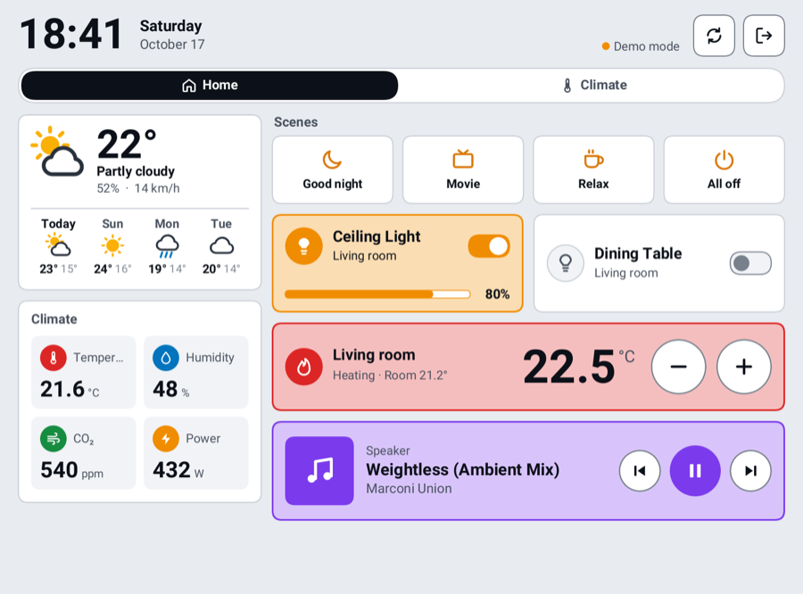
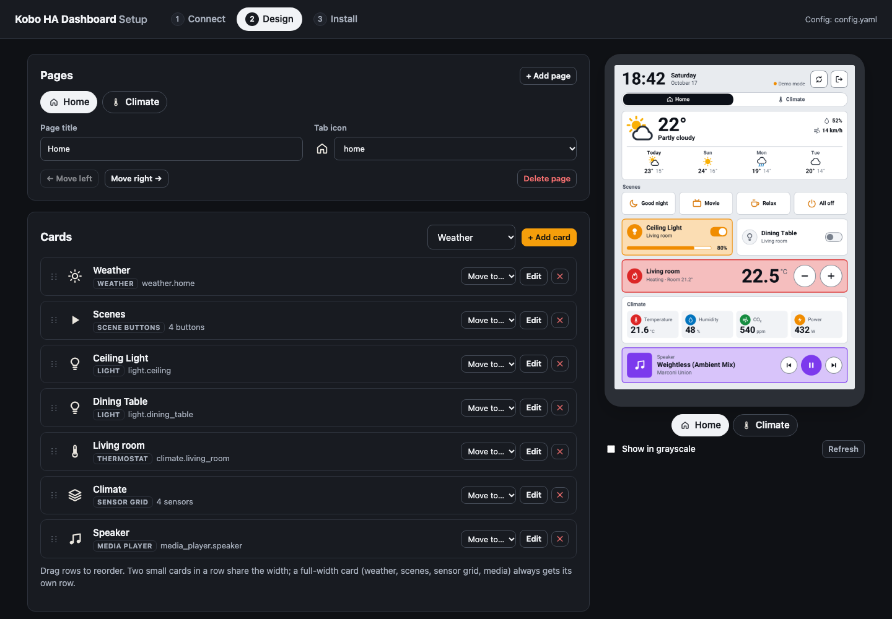

# Kobo HA Dashboard

[](https://github.com/armamut/kobo-ha-dashboard/actions/workflows/ci.yml)

A touch-friendly [Home Assistant](https://www.home-assistant.io/) dashboard for Kobo e-readers. It runs on the Kobo itself, with no extra apps or launchers needed, and comes with a desktop setup tool that builds your dashboard from your Home Assistant and installs it over USB.

[Türkçe README](README.tr.md)

<p align="center">
  
  &nbsp;
  
</p>

## Features

- **Made for e-ink:** large type for 300 ppi screens, saturated colours that survive the Kaleido colour filter, and partial refreshes that only redraw what changed.
- **Cards:** lights, switches, fans, thermostats (with +/- buttons), sensors with 24-hour graphs, sensor grids, media players, weather with forecast, and scene/script buttons.
- **Setup tool:** connect Home Assistant, get a starter dashboard generated from your areas, rearrange it with a live, pixel-exact preview, and install with one click.
- **11 languages:** English, Türkçe, Deutsch, Français, Español, Italiano, Nederlands, Português, Polski, 日本語 and 简体中文, for both the dashboard and the setup tool. The setup tool asks for your language when it first opens.
- **Portrait or landscape**, and four themes: colour, high-contrast black & white, warm paper, and dark.
- **Safe exit:** the Kobo's reading software is paused while the dashboard runs and resumed afterwards. Tap the exit icon to go back to your books. Connecting the Kobo to a computer also returns to the reader, so it can offer to connect; a plain charger doesn't.

<p align="center">
  
</p>

## Supported devices

| Device | Status |
|---|---|
| Kobo Clara Colour | ✅ Tested |
| Kobo Clara BW, Libra Colour, Elipsa 2E (MediaTek) | 🟡 Should work, untested |
| Older Kobos (NXP i.MX: Clara HD, Clara 2E, Libra 2, Libra H2O, Sage, Forma, Elipsa) | 🟡 Experimental |
| Oldest Kobos (Touch, Glo, Mini, Aura, Aura HD, Glo HD) | 🟡 Experimental, untested |
| Tolino Shine 5, Shine Color, Vision Color (Kobo-based) | 🟡 Experimental |

The setup tool recognises newer models automatically when they are connected (Clara Colour, Clara BW, Libra Colour and the Tolino models); others can be picked from the **Kobo model** list. The model sets the preview size. On the device itself, the dashboard always uses the real screen resolution, so a wrong choice doesn't break anything.

If you try it on another model, please open an issue with your `dashboard.log` (see [Troubleshooting](#troubleshooting)).

## Quick start

1. **Download** the package for your computer from the [Releases](../../releases) page and unzip it.
2. **Run the setup tool:** start `kobo-ha-dashboard` (`kobo-ha-dashboard.exe` on Windows). It opens in your browser at `http://localhost:3000` and asks for your language first. You can change it later from the menu at the top right.
   - **macOS:** the app is not signed. Right-click it, choose **Open**, then confirm. Alternatively, run `xattr -d com.apple.quarantine kobo-ha-dashboard` in Terminal.
   - **Windows:** if SmartScreen warns you, click **More info**, then **Run anyway**.
3. **Follow the three steps:**
   1. **Connect:** enter your Home Assistant URL and a long-lived access token (your HA profile → **Security** → **Long-lived access tokens**). The **?** next to the token field walks you through it and opens the right page in your Home Assistant. Pick a language, orientation and theme, then click **Create from Home Assistant**.
   2. **Design:** rename pages, add, remove and reorder cards, and move cards between pages. The preview on the right is exactly what the Kobo will show.
   3. **Install:** connect the Kobo with USB, tap **Connect** on the Kobo, and click **Install**. If the Kobo doesn't have [NickelMenu](#about-nickelmenu) yet, the button reads **Install NickelMenu and dashboard** and does both.
4. Click **Quit** (top right) to close the setup tool. You can choose to save your changes or quit without saving.

> **Nothing is written until you click Save.** Changes show up in the preview right away, but your config file only changes when you click **Save** (or install to a Kobo). **Undo/Redo** (Ctrl+Z / Ctrl+Shift+Z, or ⌘ on a Mac) step through this session's edits, and **History** can discard unsaved changes or bring back one of the last 20 saved versions.
5. Eject the Kobo. If NickelMenu was just added, the Kobo installs it and restarts by itself; otherwise restart it. Open the menu at the bottom right of the home screen and choose **Home Dashboard**. You can change this name in step 3.

> **Use an address the Kobo can reach.** The Kobo cannot resolve `.local` names (mDNS), so use Home Assistant's IP address, for example `http://192.168.1.10:8123`. The setup tool warns you and suggests the IP. Giving Home Assistant a fixed IP (a DHCP reservation in your router) keeps it from changing.

## About NickelMenu

Kobo e-readers can't run third-party apps on their own. The dashboard is started from a menu entry added by [NickelMenu](https://pgaskin.net/NickelMenu/) ([source](https://github.com/pgaskin/NickelMenu)), a small, widely used open-source add-on by Patrick Gaskin. Many people already have it, for example from KOReader or Cobalt.

- **What gets installed:** a single file, `KoboRoot.tgz`, is copied into the Kobo's `.kobo` folder. That is the Kobo's own update mechanism: on the next restart it unpacks the add-on (`libnm.so`) and its documentation (`.adds/nm/doc`). Your books, settings and Kobo account are not touched, and nothing is jailbroken.
- **The setup tool does it for you:** it downloads NickelMenu **v0.6.0** from the official GitHub release, checks it against the published SHA-256 checksum, and never overwrites a different update package that is already waiting.
- **Already installed?** The setup tool shows **NickelMenu installed** when it finds `.adds/nm/doc` on the Kobo.
- **Compatibility:** NickelMenu needs firmware 4.6 or newer and doesn't support firmware 5.x yet; the setup tool warns you about unsupported firmware.
- **Removing it:** create an empty file named `uninstall` in `.adds/nm/` on the Kobo and restart it. NickelMenu also removes itself if it ever causes a crash at startup.

If you prefer to install it by hand, follow the [official instructions](https://pgaskin.net/NickelMenu/).

## Using the dashboard

- Tap a card to toggle it. Thermostats have **−** and **+** buttons, media players have playback controls.
- Tabs at the top switch pages. The **refresh** button reloads states, and tapping the weather card does the same.
- The **light** button switches the Kobo's frontlight on or off. In the setup tool you can also have the light turn off automatically after a period without taps (30 seconds to 10 minutes), which saves a lot of battery on a desk; a tap brings it back. The original brightness is restored when you leave the dashboard.
- The **exit** button (top right) returns to the Kobo reader. The **power button** puts the dashboard to sleep when sleep mode is on; while charging or with sleep mode off it switches the light off and on.
- The status line shows **Live** with the time of the last update, **Offline**, or **Demo mode** (no token configured).

## Battery life

The Kobo itself normally sleeps whenever you aren't reading; while the dashboard is open it would stay fully awake. Two things keep that in check:

- **Always on:** Home Assistant pushes changes over its WebSocket API instead of the dashboard downloading every entity once a minute, so the screen only redraws when something visible changes. The Wi-Fi chip may power-save between packets, and only one CPU core is used. Weather forecasts and graph history are fetched every 30 minutes.
- **Sleep mode (optional):** after a period without taps (5 minutes to 1 hour, set in the setup tool), the Kobo suspends to RAM like it does when you close a book. The screen keeps showing the dashboard, with a note in place of the page tabs ("Sleep mode · Next update 22:57 · Press the power button to wake the dashboard"). It wakes on its own every 5 minutes to 1 hour to refresh the data, then goes back to sleep. Press the power button to use the dashboard again.

Sleep mode switches Wi-Fi off before suspending (suspending with Wi-Fi on can crash Kobo kernels) and reconnects with the networks you saved in the Kobo's settings when it wakes. It never suspends while the Kobo is plugged in, because that hangs MediaTek-based Kobos. Wi-Fi chips that need special handling (NXP "moal", used in some newer models) are not supported yet; the dashboard then simply stays awake.

## Languages

The language is set in the setup tool, or with `theme.language` in `config.yaml`. Dates, weather conditions, device states and number formats follow the chosen language.

Chinese and Japanese need an extra font (Noto Sans SC / JP, about 8 MB). The setup tool downloads it once and copies it to the Kobo during installation.

### Adding or improving a translation

Translations live in two places, one YAML file per language in each:

- [`lang/`](lang/): text shown on the Kobo (dates, states, weather…)
- [`lang/setup/`](lang/setup/): the setup tool's interface

To add a language:

1. Copy `lang/en.yaml` to `lang/<code>.yaml` and `lang/setup/en.yaml` to `lang/setup/<code>.yaml`, then translate the values. Keep `{placeholders}` and HTML tags as they are.
2. Add both files to the `BUILTIN` and `SETUP_BUILTIN` lists in `src/i18n.rs`.
3. Run `cargo test`. A test fails if a key from the English file is missing, an unknown key was added, or a placeholder was lost.

Tip: open the setup tool with `?lang=<code>` (for example `http://localhost:3000/?lang=de`) to check a translation quickly.

You can also override strings without rebuilding: put a file such as `de.yaml` with only the keys you want to change into `.kobo-ha/lang/` on the Kobo.

## Configuration

The setup tool writes `config.yaml` for you. If you prefer editing it by hand, [`config.example.yaml`](config.example.yaml) documents every option and card type. On the Kobo, the file lives at `.kobo-ha/config.yaml`. The setup tool's **Load its config** button reads it back for editing.

## Troubleshooting

- **Log file:** each start writes `.kobo-ha/dashboard.log` on the Kobo (the previous run is kept as `dashboard.log.old`). It shows the screen format, the e-ink refresh method and the touch device that were detected.
- **The Kobo freezes and then reboots:** Kobo firmware has a watchdog (`sickel`) that restarts the device when the reading app stops responding. The launcher pauses it together with the reading app. If you see this, reinstall with the setup tool to get the current launcher.
- **The picture is rotated or upside down:** set `device.fb_rotation` to `0`, `90`, `180` or `270`.
- **Taps land in the wrong place:** adjust `swap_touch_xy`, `invert_touch_x` and `invert_touch_y`.
- **The clock is wrong:** set `theme.utc_offset` (the setup tool's **Use mine** button fills it in). The Kobo keeps its system clock in UTC.
- **"Offline":** check the URL from another device on the same Wi-Fi. If Home Assistant sits behind a reverse proxy or Cloudflare, HTTPS usually runs on the default port, so leave out `:8123`.
- **Battery drains fast:** turn on sleep mode (see [Battery life](#battery-life)), or keep the Kobo on a charger if you use it as a wall panel. The log records the battery level every 10 minutes, so you can compare settings.
- **Sleep mode doesn't start:** the log says why (`Sleep mode: unavailable, …`). It never sleeps while the Kobo is plugged in, by design. If the Kobo hangs while asleep, hold the power button for about 15 seconds to restart it, set sleep mode to **Never**, and please open an issue with `dashboard.log.old`.

## Building from source

Requirements: [Rust](https://rustup.rs/). For the Kobo build you also need [zig](https://ziglang.org/) and `cargo install cargo-zigbuild`.

```bash
cargo run                      # setup tool (opens the browser)
cargo run -- --simulator       # interactive simulator at http://localhost:3000
cargo test                     # unit tests, including translation completeness
./deploy/build-kobo.sh         # ARMv7 build for the Kobo
./deploy/install.sh            # copy the build + ./config.yaml to a connected Kobo
```

When run from the project folder, the setup tool picks up the ARM build from `target/armv7-unknown-linux-musleabihf/release/` automatically.

Releases are built by GitHub Actions: pushing a tag like `v0.2.0` produces packages for macOS (Apple silicon and Intel), Windows and Linux. Each package contains the Kobo program in its `kobo/` folder.

### How it works

- `src/display/framebuffer.rs` draws into `/dev/fb0` and triggers e-ink updates through the MediaTek (`hwtcon`) or NXP (`mxcfb`) refresh ioctls, with FBInk as a fallback.
- `src/input/evdev.rs` reads the touch screen and grabs it so the paused reading app doesn't receive the taps. The reading app keeps the power button to itself, so presses are noticed through its interrupt counter, and the presses queued for the reading app are discarded on exit.
- `src/ui/` lays out and renders the cards with [tiny-skia](https://github.com/RazrFalcon/tiny-skia) and [fontdue](https://github.com/mooman219/fontdue). The same renderer produces the setup tool's preview.
- `src/setup/` is the setup tool: a local web app served on `127.0.0.1` only, since it handles your token.
- `deploy/launch.sh` is started by NickelMenu. It pauses the reading app and its watchdog, runs the dashboard, and always resumes them.

## Built with Claude

This project was built with [Claude Code](https://claude.com/claude-code), Anthropic's AI coding assistant, working together with the maintainer: from debugging the Kobo freeze and writing the e-ink and touch drivers to the setup tool, the translations and this README. Bug reports and pull requests from humans are very welcome.

## Credits

- [NickelMenu](https://pgaskin.net/NickelMenu/) by Patrick Gaskin, for the menu entry.
- [KOReader](https://github.com/koreader/koreader) and [FBInk](https://github.com/NiLuJe/FBInk), whose documented device knowledge (touch layouts, e-ink ioctls, the Nickel watchdog) made this possible.
- Fonts: [Roboto](https://github.com/googlefonts/roboto) (embedded) and [Noto Sans CJK](https://github.com/notofonts/noto-cjk) (downloaded on demand, SIL Open Font License).

Not affiliated with Rakuten Kobo or Home Assistant.

## License

[MIT](LICENSE)
