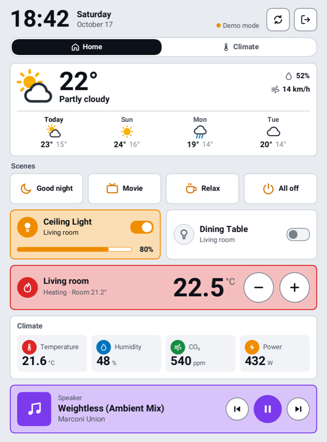

# Kobo HA Dashboard

Kobo e-okuyucular için dokunmatik bir [Home Assistant](https://www.home-assistant.io/) paneli. Doğrudan Kobo üzerinde çalışır, ek uygulama veya başlatıcı gerektirmez. Bilgisayarda çalışan kurulum aracı, panelinizi Home Assistant'tan otomatik oluşturur ve USB ile Kobo'ya kurar.

[English README](README.md)

  

## Özellikler

- **E-ink için tasarlandı:** 300 ppi ekran için büyük yazılar, Kaleido renk filtresinde kaybolmayan canlı renkler, sadece değişen bölgeyi yenileyen kısmi güncelleme.
- **Kartlar:** ışık, anahtar, fan, termostat (+/- butonlu), 24 saatlik grafikli sensör, sensör ızgarası, medya oynatıcı, tahminli hava durumu, sahne/script butonları.
- **Kurulum aracı:** Home Assistant'a bağlanır, alanlarınıza göre başlangıç paneli oluşturur, kartları canlı önizlemeyle düzenletir ve tek tıkla kurar. Önizleme, Kobo'nun göstereceğiyle birebir aynıdır.
- **11 dil:** English, Türkçe, Deutsch, Français, Español, Italiano, Nederlands, Português, Polski, 日本語, 简体中文. Hem panel hem kurulum aracı çevrili; araç ilk açılışta dilinizi sorar.
- **Model desteği:** Clara Colour, Clara BW, Libra Colour ve Tolino modelleri bağlanınca otomatik tanınır; diğerleri listeden seçilir. Cihazda her zaman gerçek ekran çözünürlüğü kullanılır.
- Dikey veya yatay kullanım ve dört tema: renkli, yüksek kontrast siyah-beyaz, sıcak kağıt, koyu.
- **Güvenli çıkış:** Kobo'nun okuma yazılımı dashboard açıkken duraklatılır, çıkınca devam eder. Çıkış simgesine dokunun ya da güç tuşuna basın.

## Hızlı başlangıç

1. [Releases](../../releases) sayfasından bilgisayarınıza uygun paketi indirip açın.
2. `kobo-ha-dashboard` programını çalıştırın (Windows'ta `.exe`). Tarayıcıda `http://localhost:3000` açılır ve önce dilinizi sorar.
   - **macOS:** uygulama imzalı değil. Sağ tıklayıp **Aç** deyin ve onaylayın.
   - **Windows:** SmartScreen uyarı verirse **Ek bilgi** → **Yine de çalıştır** deyin.
3. Üç adımı izleyin:
   1. **Bağlan:** HA adresi ve uzun ömürlü erişim belirteci girin (HA profili → **Güvenlik** → **Uzun ömürlü erişim belirteçleri**). Token alanının yanındaki **?** adım adım anlatır ve Home Assistant'ınızda doğru sayfayı açar. Dili, yönü ve temayı seçip **Home Assistant'tan oluştur**'a basın.
   2. **Tasarla:** sayfaları ve kartları düzenleyin; sağdaki önizleme Kobo'da göreceğinizin aynısıdır.
   3. **Kur:** Kobo'yu USB ile bağlayın, Kobo'da **Bağlan**'a dokunun ve **Kur**'a basın. Kobo'da [NickelMenu](#nickelmenu-hakkında) yoksa buton **NickelMenu ve paneli kur** olarak görünür ve ikisini birden yapar.
4. Sağ üstteki **Çıkış** ile kurulum aracını kapatın. Değişiklikleri kaydedip ya da kaydetmeden çıkabilirsiniz.

> **Kaydet'e basmadan hiçbir şey dosyaya yazılmaz.** Değişiklikler önizlemede hemen görünür, ama config dosyanız yalnızca **Kaydet**'e bastığınızda (ya da Kobo'ya kurduğunuzda) değişir. **Geri al / Yinele** (Ctrl+Z / Ctrl+Shift+Z, Mac'te ⌘) bu oturumdaki adımlar arasında gezer; **Geçmiş** kaydedilmemiş değişiklikleri atar ya da son 20 kayıtlı sürümden birini geri getirir.
5. Kobo'yu çıkarın. NickelMenu yeni eklendiyse Kobo onu kurup kendiliğinden yeniden başlar; değilse siz yeniden başlatın. Ana ekranın sağ altındaki menüden **Home Dashboard**'u seçin. Bu adı 3. adımda değiştirebilirsiniz.

> Kobo `.local` adreslerini çözemez. Home Assistant'ın IP adresini kullanın (ör. `http://192.168.1.10:8123`); kurulum aracı bunu otomatik önerir.

## Paneli kullanma

- Bir karta dokunmak onu açıp kapatır; termostatlarda **−** / **+**, medya oynatıcıda oynatma butonları vardır.
- Üst çubuktaki **ışık** butonu Kobo'nun ön ışığını açıp kapatır. Kurulum aracında ışığın, belirli bir süre dokunulmayınca (30 saniye – 10 dakika) otomatik kapanmasını da seçebilirsiniz; masaüstünde pilden çok tasarruf sağlar. Bir dokunuş ışığı geri açar. Panelden çıkınca ışık eski parlaklığına döner.
- **Çıkış** butonu ya da Kobo'nun **güç tuşu** okuma ekranına geri döndürür.

## NickelMenu hakkında

Kobo kendi başına üçüncü parti uygulama çalıştıramaz. Panel, Patrick Gaskin'in geliştirdiği küçük ve yaygın kullanılan açık kaynaklı eklenti [NickelMenu](https://pgaskin.net/NickelMenu/) ([kaynak kod](https://github.com/pgaskin/NickelMenu)) tarafından eklenen menü girdisiyle başlatılır. KOReader veya Cobalt kullananlarda genellikle zaten kuruludur.

- **Ne kurulur:** Kobo'nun `.kobo` klasörüne tek bir `KoboRoot.tgz` dosyası kopyalanır. Bu, Kobo'nun kendi güncelleme yöntemidir: bir sonraki açılışta eklentiyi (`libnm.so`) ve dokümanını (`.adds/nm/doc`) açar. Kitaplarınıza, ayarlarınıza ve Kobo hesabınıza dokunulmaz; "root"lama ya da jailbreak yoktur.
- **Kurulum aracı sizin yerinize yapar:** NickelMenu **v0.6.0**'ı resmi GitHub sürümünden indirir, yayınlanan SHA-256 özetiyle doğrular ve bekleyen başka bir güncelleme paketinin üzerine asla yazmaz.
- **Zaten kurulu mu?** Kurulum aracı Kobo'da `.adds/nm/doc` dosyasını bulursa **NickelMenu kurulu** gösterir.
- **Uyumluluk:** NickelMenu 4.6 veya üstü yazılım ister, 5.x sürümlerini henüz desteklemez; araç desteklenmeyen sürümde uyarır.
- **Kaldırmak için:** Kobo'da `.adds/nm/` klasörüne `uninstall` adında boş bir dosya oluşturup yeniden başlatın. Açılışta bir hataya yol açarsa NickelMenu kendini zaten otomatik kaldırır.

## Sorun giderme

- **Günlük dosyası:** Kobo'daki `.kobo-ha/dashboard.log`.
- **Cihaz donup yeniden başlıyorsa:** Kobo'nun `sickel` watchdog'u, okuma yazılımı yanıt vermeyince cihazı yeniden başlatır. Güncel başlatıcı onu da duraklatır; kurulum aracıyla yeniden kurun.
- **Görüntü ters veya yan çıkıyorsa:** `device.fb_rotation` değerini `0`, `90`, `180` veya `270` yapın.
- **Saat yanlışsa:** `theme.utc_offset` ayarlayın (kurulum aracındaki **Use mine** butonu doldurur).
- **"Bağlantı yok":** reverse proxy veya Cloudflare arkasında HTTPS genelde varsayılan porttadır; `:8123` yazmayın.

Ayrıntılar, çeviri ekleme ve kaynaktan derleme için [İngilizce README](README.md)'ye bakın.

## Claude ile yapıldı

Bu proje, Anthropic'in yapay zekâ kodlama asistanı [Claude Code](https://claude.com/claude-code) ile, proje sahibiyle birlikte çalışılarak geliştirildi: Kobo'nun donma sorununun çözülmesinden e-ink ve dokunmatik sürücülerine, kurulum aracından çevirilere ve bu README'ye kadar. Hata bildirimleri ve katkılar memnuniyetle karşılanır.

## Lisans

[MIT](LICENSE)
