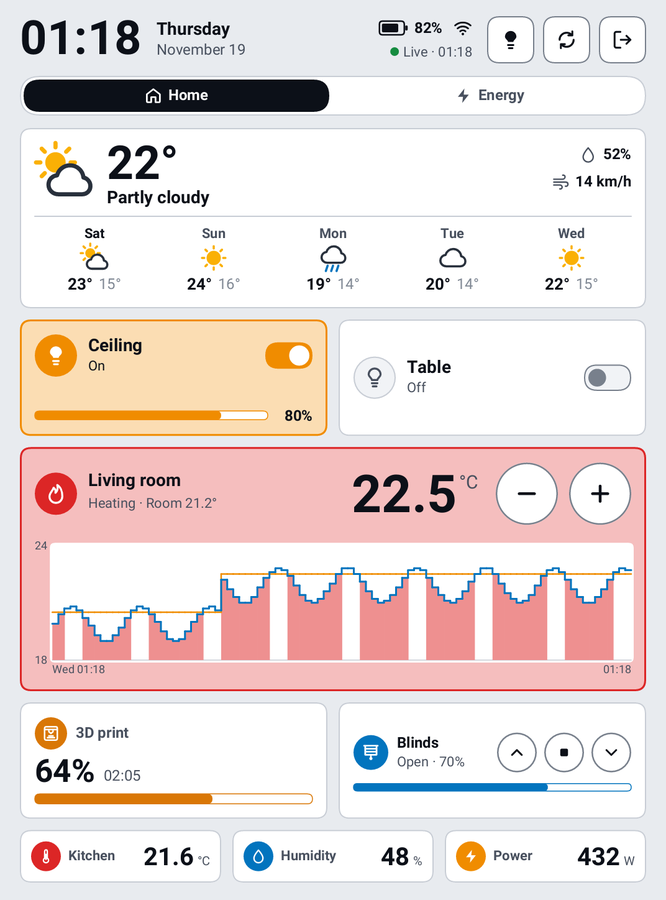
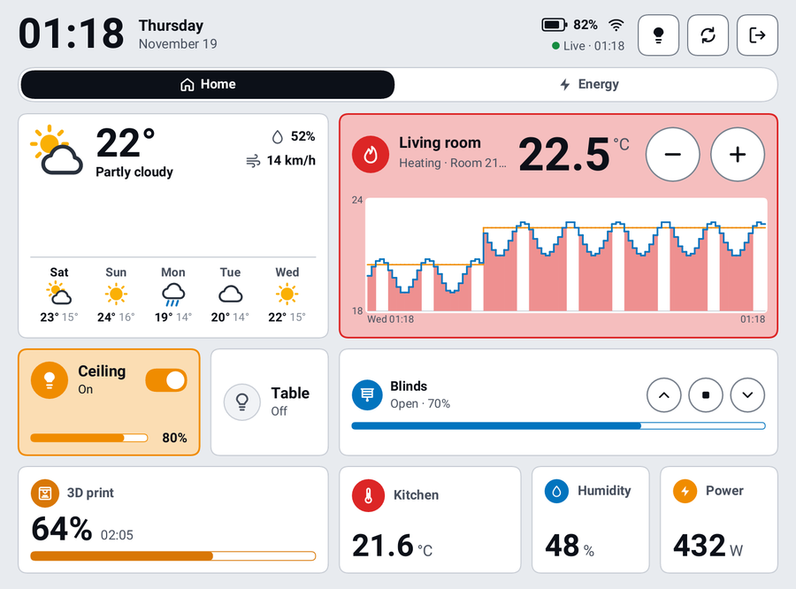
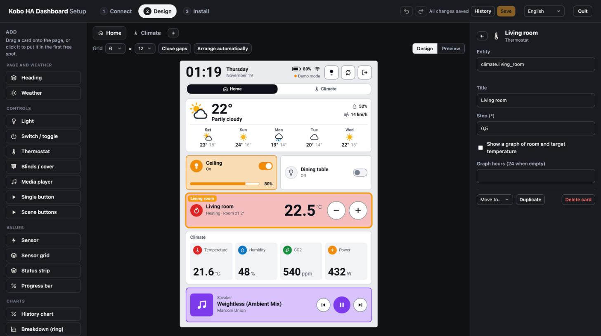

# Kobo HA Dashboard

Kobo e-okuyucular için dokunmatik bir [Home Assistant](https://www.home-assistant.io/) paneli. Doğrudan Kobo üzerinde çalışır, ek uygulama veya başlatıcı gerektirmez. Bilgisayarda çalışan kurulum aracı, panelinizi Home Assistant'tan otomatik oluşturur ve USB ile Kobo'ya kurar.

[English README](README.md)

  
  &nbsp;
  

## Özellikler

- **E-ink için tasarlandı:** 300 ppi ekran için büyük yazılar, Kaleido renk filtresinde kaybolmayan canlı renkler, sadece değişen bölgeyi yenileyen kısmi güncelleme.
- **Kartlar:** ışık, anahtar, fan, termostat (+/- butonlu), 24 saatlik grafikli sensör (kapı, hareket gibi ikili sensörler ve kilitler *Açık / Kapalı*, *Algılandı / Temiz* gibi durumlarla görünür), sensör ızgarası, medya oynatıcı, tahminli hava durumu, sahne/script butonları, panjur ve perdeler (aç, durdur, kapat ve konum), ilerleme çubukları (bir baskı ya da yıkama, bitiş saatiyle), toplu durum şeritleri (birçok varlık bir bakışta), dağılım halkaları (bir toplamın cihazlara dağılımı), oda ve hedef sıcaklığı ile ısıtmanın çalıştığı zamanları gösteren grafikli termostatlar, bölüm başlıkları, Home Assistant istatistiklerinden grafikler (dikey ya da yatay çubuk veya çizgi, saatler ya da günler boyunca) ve resimler: `image` ile `camera` entity'lerinden ya da kurulum aracında eklediğiniz kendi dosyanızdan.
- **Kurulum aracı:** Home Assistant'a bağlanır, alanlarınıza göre başlangıç paneli oluşturur ya da mevcut bir Lovelace dashboard'unu içe aktarıp kartlarını panelin kendi kartlarına çevirir, kartları sürükle-bırak tasarımcıda bir ızgaraya yerleştirtir ve tek tıkla kurar. Önizleme, Kobo'nun göstereceğiyle birebir aynıdır.
- **13 dil:** English, Türkçe, Deutsch, Français, Español, Italiano, Nederlands, Português, Polski, Русский, Українська, 日本語, 简体中文. Hem panel hem kurulum aracı çevrili; araç ilk açılışta dilinizi sorar.
- **Model desteği:** Clara Colour, Clara BW, Libra Colour, Tolino modelleri ve eski Glo, Aura, Nia, Glo HD, Aura HD, Aura H2O, Touch ve Mini bağlanınca otomatik tanınır; diğerleri listeden seçilir. Cihazda her zaman gerçek ekran çözünürlüğü kullanılır.
- Dikey veya yatay kullanım ve dört tema: renkli, yüksek kontrast siyah-beyaz, sıcak kağıt, koyu.
- **Yeni sürümler:** panel ve kurulum aracı günde bir kez yeni sürüm olup olmadığına bakar ve sürüm notlarını gösterir; istemediğiniz bir sürümü atlayabilirsiniz (bkz. [Güncellemeler](#güncellemeler)).
- **Güvenli çıkış:** Kobo'nun okuma yazılımı dashboard açıkken duraklatılır, çıkınca devam eder. Çıkış simgesine dokunun. Kobo'yu bilgisayara bağlayınca da okuma ekranına dönülür, böylece bağlanmayı sorabilir; sadece şarj cihazına takmak paneli kapatmaz.

  

## Hızlı başlangıç

1. [Releases](../../releases) sayfasından bilgisayarınıza uygun paketi indirip açın.
2. `kobo-ha-dashboard` programını çalıştırın (Windows'ta `.exe`). Tarayıcıda `http://localhost:3000` açılır ve önce dilinizi sorar.
   - **macOS:** uygulama imzalı değil. Sağ tıklayıp **Aç** deyin ve onaylayın.
   - **Windows:** SmartScreen uyarı verirse **Ek bilgi** → **Yine de çalıştır** deyin.
3. Üç adımı izleyin:
   1. **Bağlan:** HA adresi ve uzun ömürlü erişim belirteci girin (HA profili → **Güvenlik** → **Uzun ömürlü erişim belirteçleri**). Token alanının yanındaki **?** adım adım anlatır ve Home Assistant'ınızda doğru sayfayı açar. Dili, yönü ve temayı seçip **Home Assistant'tan oluştur**'a basın.
   2. **Tasarla:** sayfa pencereyi kaplar; solda ekleyebileceğiniz kartlar (sayfaya sürükleyin ya da tıklayın), sağda seçili kartın (ya da sayfanın) ayarları durur. Bir karta sağ tıklayarak çoğaltabilir, türünü değiştirebilir, başka sayfaya taşıyabilir, doğal ya da en küçük boyutuna getirebilir veya silebilirsiniz; sayfa sekmelerini sürükleyerek sıralayın. Her sayfa bir ızgaradır: kartları sürükleyip istediğiniz yere koyun, kenarından ya da köşesinden sürükleyerek boyutlandırın (küçük bir kart daha az şey gösterir, en küçüğünde ikon ve değer), sayfanın kaç sütun ve satır olacağını seçin. Sayfa sekmelerinin yanındaki **+** ile boş bir sayfa, tüm ışıklarınızın (termostatlarınızın, panjurlarınızın, anahtarlarınızın) olduğu bir sayfa ekleyin ya da bir Lovelace panosunu içe aktarın; sığmayan kartlar sayfanın yanında bekler. **Önizleme** (ya da P tuşu) sayfayı Kobo'da göreceğinizin aynısı olarak, istenirse gri tonlamalı ya da uyku ekranıyla gösterir; orada dokunuşlar da çalışır (ışıklar açılıp kapanır, sekmeler değişir, ışık düğmesi ekranı karartır), Home Assistant'a bir şey gönderilmez.
   3. **Kur:** Kobo'yu USB ile bağlayın, Kobo'da **Bağlan**'a dokunun ve **Kur**'a basın. Kobo'da [NickelMenu](#nickelmenu-hakkında) yoksa buton **NickelMenu ve paneli kur** olarak görünür ve ikisini birden yapar.
4. Sağ üstteki **Çıkış** ile kurulum aracını kapatın. Değişiklikleri kaydedip ya da kaydetmeden çıkabilirsiniz.

> **Kaydet'e basmadan hiçbir şey dosyaya yazılmaz.** Değişiklikler önizlemede hemen görünür, ama config dosyanız yalnızca **Kaydet**'e bastığınızda (ya da Kobo'ya kurduğunuzda) değişir. **Geri al / Yinele** (Ctrl+Z / Ctrl+Shift+Z, Mac'te ⌘) bu oturumdaki adımlar arasında gezer; **Geçmiş** kaydedilmemiş değişiklikleri atar ya da son 20 kayıtlı sürümden birini geri getirir.
5. Kobo'yu çıkarın (kurulum aracında Kobo'nun yanındaki **Kobo'yu çıkar** düğmesi bunu yapar). NickelMenu yeni eklendiyse Kobo onu kurup kendiliğinden yeniden başlar; değilse siz yeniden başlatın. Ana ekranın sağ altındaki menüden **Home Dashboard**'u seçin. Bu adı 3. adımda değiştirebilirsiniz.

> Kobo `.local` adreslerini çözemez. Home Assistant'ın IP adresini kullanın (ör. `http://192.168.1.10:8123`); kurulum aracı bunu otomatik önerir.

## Paneli kullanma

- Bir karta dokunmak onu açıp kapatır; termostatlarda **−** / **+**, medya oynatıcıda oynatma butonları vardır.
- Üst çubuktaki **ışık** butonu Kobo'nun ön ışığını açıp kapatır. Kurulum aracında ışığın, belirli bir süre dokunulmayınca (30 saniye – 10 dakika) otomatik kapanmasını da seçebilirsiniz; masaüstünde pilden çok tasarruf sağlar. Bir dokunuş ışığı geri açar. Panelden çıkınca ışık eski parlaklığına döner.
- **Göz** butonu Kobo'yu uyanık tutar: açıkken (koyu dolu, açık göz) ışık açık da olsa kapalı da olsa uyku modu devreye girmez ve ışık kendiliğinden sönmez. Tekrar dokununca normale döner. Güç tuşu yine uyutur ve göz kapanır; paneli bir sonraki açışta da kapalı başlar, yani açık unutulup pili bitiremez. Yalnızca uyku modu ya da ışığın otomatik kapanması seçiliyse görünür; varsayılan olarak üst çubuğu dolu olan, dik tutulan 6" Kobo'larda (Glo, Aura, Nia...) gösterilmez. Kurulum aracından her yerde gösterilmesini ya da gizlenmesini seçebilirsiniz.
- **Çıkış** butonu (sağ üst) okuma ekranına geri döndürür. **Güç tuşu**, uyku modu açıksa paneli uyutur; şarjdayken, Bluetooth açıkken ya da uyku modu kapalıyken ışığı kapatıp açar.
- Yeni bir sürüm çıktığında üst çubukta noktalı bir düğme belirir: sürüm notlarını gösterir ve o sürümü atlamanızı sağlar.

## Pil ömrü

- **Her zaman açık tasarruf:** Home Assistant değişiklikleri WebSocket üzerinden anında bildirir; panel her dakika tüm entity'leri indirmez. Ekran varsayılan olarak dakikada bir, sadece görünen bir şey değiştiyse yenilenir; bir dokunuştan hemen sonra değişiklikler anında görünür. Daha fazla tasarruf için kurulum aracında *Ekran güncelleme aralığı*nı uzatıp saati gizleyebilirsiniz (*Saat: Gösterme*); saat açıkken ekran her dakika değişir. Wi-Fi çipi paketler arasında güç tasarrufu yapar, tek işlemci çekirdeği kullanılır. Hava tahmini ve grafik geçmişi 30 dakikada bir alınır.
- **Uyku modu (isteğe bağlı):** belirli bir süre dokunulmazsa (kurulum aracında 5 dakika – 1 saat) Kobo, kitabı kapattığınızdaki gibi uykuya geçer. Ekran paneli göstermeye devam eder; sekmelerin yerinde "Uyku modu · Sonraki güncelleme 22:57 · Paneli uyandırmak için güç tuşuna basın" yazar. Belirlediğiniz aralıkla (5 dakika – 1 saat) kendiliğinden uyanıp verileri tazeler ve tekrar uyur. Tekrar kullanmak için güç tuşuna basın.
- Uyku modu uyumadan önce Wi-Fi'yi kapatır (Wi-Fi açıkken uyumak Kobo çekirdeğini çökertebilir), uyanınca Kobo ayarlarında kayıtlı ağlara yeniden bağlanır. Şarja takılıyken asla uyumaz, çünkü bu MediaTek tabanlı Kobo'ları kilitler. Kobo ayarlarında **Bluetooth** açıkken de uyumaz: yazılım 6.0'da bu Wi-Fi/Bluetooth yongasını çökertiyor ve Wi-Fi yeniden başlatana kadar gelmiyor. Işık yine bir süre sonra söner ve güç tuşu ışığı açıp kapatır, ama pil daha çabuk biter. Uyku modunu kullanmak için Bluetooth'u kapatın.
- Şarj kablosu takılı değilken pil %3'e inince (`config.yaml` içinde `battery_critical_percent`, 0 kapatır) panel, uyku modu kapalı olsa bile ekrana "Pil bitti" yazar ve uykuya geçer. E-ink yazıyı güç harcamadan korur. 5 dakikada bir ve güç tuşuna her basıldığında şarja takılıp takılmadığına bakar, takılınca kendiliğinden geri gelir.
- **Pil seviyesi Home Assistant'ta (isteğe bağlı):** kurulum aracında *Kobo'nun pil seviyesini Home Assistant'a gönder* seçeneğini açınca panel pil seviyesini bir sensöre yazar (varsayılan `sensor.kobo_battery`, `charging` özelliğiyle). Örneğin %20'de akıllı prizi açıp %85'te kapatan bir otomasyon kurabilirsiniz. Seviye değişince (en az 10 dakikada bir), kablo takılıp çıkarılınca hemen, "Pil bitti"den önce ve uyku modunda her uyanışta gönderilir. Token admin kullanıcıya ait olmalı. Home Assistant yeniden başlayınca sensör bir sonraki güncellemeye kadar kaybolur.
- **Uyku modu çalışmıyorsa:** `dashboard.log` nedenini yazar. Uykudayken takılırsa güç tuşuna yaklaşık 15 saniye basılı tutarak yeniden başlatın, uyku modunu **Hiçbir zaman** yapın ve `dashboard.log.old` ile bir sorun bildirin.

## Güncellemeler

Panel (Wi-Fi açıkken) ve kurulum aracı günde bir kez GitHub'a en son sürümü sorar. İstekle yalnızca genel bir program adı gider; sizin ya da Home Assistant'ınız hakkında bir bilgi gitmez. Daha yeni bir sürüm çıktıysa:

- kurulum aracında sürüm notlarını ve sisteminize uygun paketi indiren bir **İndir** düğmesini içeren bir bant görünür;
- Kobo'da üst çubukta notları açan bir düğme belirir.

İkisinde de **Bu sürümü atla** denebilir; o sürüm bir daha önerilmez, ama sonraki sürümler önerilir. Kurmak için yeni paketi indirip kurulum aracını çalıştırın ve her zamanki gibi Kobo'ya kurun; ayarlarınız korunur. Denetimi kurulum aracındaki *Yeni sürümleri denetle* kutusuyla ya da `config.yaml` içinde `updates.check: false` ile kapatabilirsiniz.

## NickelMenu hakkında

Kobo kendi başına üçüncü parti uygulama çalıştıramaz. Panel, Patrick Gaskin'in geliştirdiği küçük ve yaygın kullanılan açık kaynaklı eklenti [NickelMenu](https://pgaskin.net/NickelMenu/) ([kaynak kod](https://github.com/pgaskin/NickelMenu)) tarafından eklenen menü girdisiyle başlatılır. KOReader veya Cobalt kullananlarda genellikle zaten kuruludur.

- **Ne kurulur:** Kobo'nun `.kobo` klasörüne tek bir güncelleme paketi (`KoboRoot.tgz`, Kobo yazılımı 5.x/6.x'te `Kobo.tgz`) kopyalanır. Bu, Kobo'nun kendi güncelleme yöntemidir: bir sonraki açılışta eklentiyi (`libnm.so`) açar. Kitaplarınıza, ayarlarınıza ve Kobo hesabınıza dokunulmaz; "root"lama ya da jailbreak yoktur.
- **Kurulum aracı sizin yerinize yapar:** Kobo'nun yazılımına uygun sürümü seçer, GitHub'dan indirir, sabitlenmiş SHA-256 özetiyle doğrular ve bekleyen başka bir güncelleme paketinin üzerine asla yazmaz.
  - Kobo yazılımı **4.6 – 4.x:** resmi NickelMenu **v0.6.0**.
  - Kobo yazılımı **5.x ve 6.x:** resmi sürüm bunları henüz desteklemediği için araç [Nico Verbruggen'in NickelMenu kopyasını](https://github.com/nicoverbruggen/NickelMenu/releases/tag/fork-v1.2) (**fork v1.2**, Qt6 derlemesi) kurar. Resmi değildir; aynı kaynaktan derlenmiş ve Kobo yazılımı 6.0.279225'te denenmiştir. Panel bununla bir Clara Colour'da test edildi.
  - Daha eski ya da daha yeni yazılımlarda araç desteklenmediğini söyler.
- **Kobo güncellemeleri NickelMenu'yü siler.** Güncellemeden sonra panelin girdisi menüden kaybolur: kurulum aracını yeniden çalıştırıp NickelMenu'yü kurun. Araç, panel menüden son açıldığından beri Kobo yazılımının değiştiğini fark edip **NickelMenu silinmiş olabilir** gösterir; aksi halde `.adds/nm/doc` dosyasını bulursa **NickelMenu kurulu** gösterir.
- **Kaldırmak için:** Kobo'da `.adds/nm/` klasörüne `uninstall` adında boş bir dosya oluşturup yeniden başlatın. Açılışta bir hataya yol açarsa NickelMenu kendini zaten otomatik kaldırır.

## Sorun giderme

- **Günlük dosyası:** Kobo'daki `.kobo-ha/dashboard.log` (bir önceki çalıştırmanınki `dashboard.log.old`). 1 MB'ı geçen günlük `.old` olarak saklanıp yeniden başlar, böylece ikisi birlikte 2 MB'ı geçmez; kurulum aracının Kur adımı eski günlükleri silebilir.
- **Cihaz donup yeniden başlıyorsa:** Kobo'nun `sickel` watchdog'u, okuma yazılımı yanıt vermeyince cihazı yeniden başlatır. Güncel başlatıcı onu da duraklatır; kurulum aracıyla yeniden kurun.
- **Görüntü ters veya yan çıkıyorsa:** `device.fb_rotation` değerini `0`, `90`, `180` veya `270` yapın.
- **Saat yanlışsa:** kurulum aracı, çalıştığı bilgisayarın saat dilimini yaz/kış saatine uyan bir kural olarak `.kobo-ha/launch.sh`'a yazar; Kobo'ya kurulum aracıyla yeniden kurmak genellikle yeter. `theme.utc_offset` sabit bir fark verir ve bu kuralın önüne geçer; sabitlemek istemiyorsanız boş bırakın.
- **"Bağlantı yok":** reverse proxy veya Cloudflare arkasında HTTPS genelde varsayılan porttadır; `:8123` yazmayın.

Ayrıntılar, çeviri ekleme ve kaynaktan derleme için [İngilizce README](README.md)'ye bakın.

## Claude ile yapıldı

Bu proje, Anthropic'in yapay zekâ kodlama asistanı [Claude Code](https://claude.com/claude-code) ile, proje sahibiyle birlikte çalışılarak geliştirildi: Kobo'nun donma sorununun çözülmesinden e-ink ve dokunmatik sürücülerine, kurulum aracından çevirilere ve bu README'ye kadar. Hata bildirimleri ve katkılar memnuniyetle karşılanır.

## Lisans

[MIT](LICENSE)
